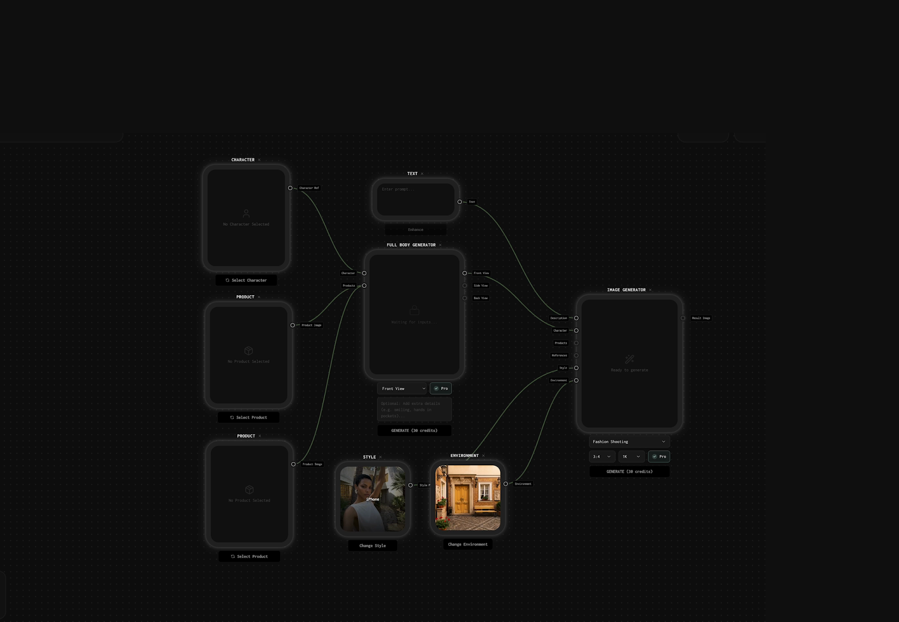

The Rainfrog node canvas is your creative workspace. Instead of starting from a blank text prompt, you build a visual graph by connecting asset nodes to generator nodes. Rainfrog reads the graph and assembles the generation for you. Every choice on the canvas, from the product you feature to the lighting style, becomes part of the result.

<Frame>
  
</Frame>

## Canvas and Studio modes

Every project opens in one of two modes. Switch with the **Canvas** / **Studio** toggle at the top of the project.

| Mode | What you see | Best for |
| --- | --- | --- |
| **Canvas** | The full node graph | Building and editing workflows by hand |
| **Studio** | A form with **Image** and **Video** tabs, plus a gallery of results | Quick runs from a template without wiring nodes |

Studio mode still builds real nodes. Each run you start there places a generator on the project canvas, so you can switch to **Canvas** anytime and keep editing. On phones and tablets, projects open in Studio mode only.

## The canvas at a glance

When you open a project in the [Rainfrog studio](https://app.rainfrog.ai) in **Canvas** mode, you see:

- **Floating dock** (left) — tabs for **Templates**, **Nodes**, **Products**, **Characters**, and **Brand assets** (team workspaces). Click or drag an item onto the canvas.
- **Credits** — your balance in the studio header
- **Generation queue** — runs in progress and finished runs
- **Shortcuts** — the **i** button in the bottom-left corner lists every canvas shortcut

The canvas auto-saves as you work.

## Add nodes

You can add a node in three ways:

1. **Floating dock** — open the **Nodes** tab and click or drag a node onto the canvas
2. **Right-click** — right-click empty canvas to open the add node menu at that spot. Type to search.
3. **Drag from an image output** — drag a wire from an image output into empty space, then choose **Create Video** or **Edit Image**

The add node menu groups nodes the same way everywhere:

| Group | Nodes |
| --- | --- |
| **Generators** | Image Generator, Video Generator |
| **Input** | Character, Product, Style, Environment |
| **Utility** | Full Body Generator, Character Sheet Generator, Text, Note |
| **Media** | Image, Video |

Templates (**Fashion Shooting**, **Product Still Life**, **UGC Content**, and **Cinema**) live in the dock's **Templates** tab. Each one places a pre-wired graph. See [Templates & Gallery](/guides/templates-gallery).

## How each node works

Every node has **output handles** on its right edge and **input handles** on its left edge. Handle labels tell you what a handle sends or expects.

### Input nodes

| Node | What it does | Output |
| --- | --- | --- |
| **Character** | The person in the scene. Pick a stock or custom character from your library. | **Character Ref** |
| **Product** | The item you want to feature, from your product library | **Product Image** |
| **Style** | The visual treatment: color, light, film look. Pick a built-in or custom style. | **Style Preset** |
| **Environment** | The setting or background | **Environment** |
| **Text** | Optional direction: action, pose, framing. Not needed for most runs. | **Text** |
| **Image** | A still you upload or drop onto the canvas, used as a reference | **Image** |
| **Video** | A clip you upload, used as a reference by Seedance video models | **Video** |

### Generators

| Node | Inputs | Output |
| --- | --- | --- |
| **Image Generator** | **Description**, **Character**, **Products**, **References**, **Style**, **Environment** | **Result Image** |
| **Full Body Generator** | **Character**, **Products** | **Front View**, **Side View**, **Back View** |
| **Character Sheet Generator** | **Character**, **Products** | **Output** (one character sheet) |
| **Video Generator** | Changes with the video model you pick | **Result Video** |

**Character** and **Products** inputs accept several wires. Other inputs take one wire.

The Image Generator's **References** input takes extra pictures, such as an Image node or an earlier result. When references are connected, the generator edits from those pictures. The default **Rainfrog Core** model has no **References** input. Pick another image model when your shot needs reference pictures.

### Video Generator inputs by model

| Video model | Inputs |
| --- | --- |
| **Kling 2.6** | **Text**, **Image** (first frame), **End image** |
| **Kling 3.0** | **Text**, **First Frame**, **Last Frame**, **References** (characters and products) |
| **Seedance 2.0** / **Seedance 2.5** | **Character**, **Products**, **Environment**, **Image assets**, **Video assets** |

When you switch models, the handles change. Wires that the new model can't use are removed. See [Video generation](/guides/video-generation).

### Note

A **Note** is a sticky note for your own comments. It has no handles and is never part of a generation.

## Connect nodes

Drag from an **output handle** on one node to a matching **input handle** on another. A wire appears when the connection is valid.

- Connect outputs to inputs of the same kind, for example **Product Image** to **Products**
- An image output (an Image node or any generated still) can feed **References** or **Character** on an Image Generator
- An image output can also feed a Video Generator's first or last frame
- To remove a wire, click it and press `Delete`

### Common patterns

| Goal | Wiring |
| --- | --- |
| **Product still** | Product → **Products**. Optional Style, Environment, and Text. |
| **Fashion shot** | Character → **Character**, Product → **Products**. Optional Style, Environment, and Text. |
| **Same person, several scenes** | Character and Products into a Full Body Generator. Wire **Front View** into **Character** on each Image Generator. |
| **Edit a result** | Drag from the result and choose **Edit Image**. Rainfrog adds an Image Generator with the result in **References** and a Text node for your change. |
| **Image to video** | Drag from the result and choose **Create Video**. Rainfrog adds a Video Generator with the still as its first frame. |

<Tip>
  Changing one node changes one variable. Keep the character, product, and style wired while you swap the piece you want to explore.
</Tip>

## Move around the canvas

| Action | How |
| --- | --- |
| **Pan** | Scroll, hold `Space` and drag, or drag with the middle mouse button |
| **Zoom** | Hold `Cmd` (Mac) or `Ctrl` (Windows) and scroll, or pinch on a trackpad |
| **Select a node** | Click it |
| **Multi-select** | `Shift` + click |
| **Box select** | Drag on empty canvas |
| **Move nodes** | Drag a node, or drag a selection |
| **Find your nodes** | Use the recenter button to bring your graph back into view |

## Keyboard shortcuts

| Shortcut | Action |
| --- | --- |
| `Cmd`/`Ctrl` + `C` | Copy selected nodes |
| `Cmd`/`Ctrl` + `V` | Paste at the cursor |
| `Option`/`Alt` + drag a node | Duplicate the node |
| `Cmd`/`Ctrl` + `Z` | Undo |
| `Cmd`/`Ctrl` + `Shift` + `Z` | Redo |
| `Delete` / `Backspace` | Delete the selected nodes or wire |
| Right-click | Open the add node menu |
| `Cmd`/`Ctrl` + `S` | Save the project now |

Shortcuts pause while you type in a text field. Click the **i** button on the canvas to see the list anytime.

## Generate from the graph

Click **Generate** on any generator. Rainfrog follows every wire into that generator and builds the generation from the connected assets. The credit cost for the current settings is shown on the generator before you run. See [Generation](/concepts/generation).

<Note>
  Your graph stays in the project. Come back later, swap a node, and generate again.
</Note>
